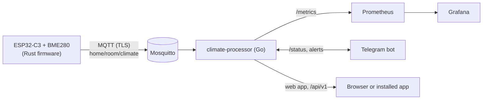
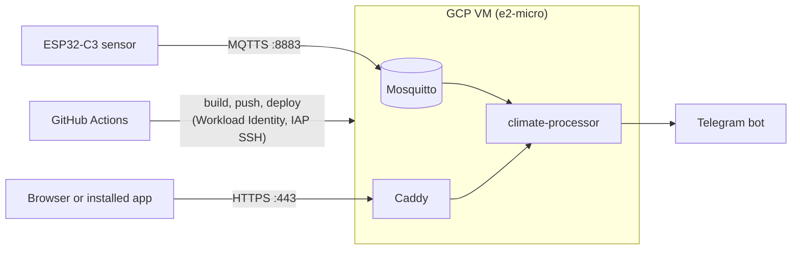
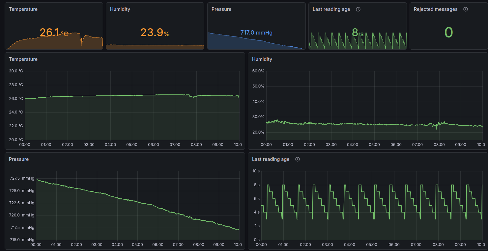

# climate-processor
[](https://github.com/Nurs717/climate-processor/actions/workflows/ci.yml) [](https://github.com/Nurs717/climate-processor/actions/workflows/firmware-ci.yml) [](https://github.com/Nurs717/climate-processor/actions/workflows/terraform-ci.yml)

A small Go service that turns room climate readings from an ESP32 + BME280 sensor into a live web dashboard that installs like an app, a small REST API, Prometheus metrics and a Telegram bot.

**Live demo: https://34-28-22-93.sslip.io** (everybody can look; the owner signs in with Telegram).



The sensor publishes `{"temperature": 21.5, "humidity": 45.2, "pressure": 101325}` (°C, %, Pa) every few seconds. The service validates each message, updates the metrics, stores the history in SQLite and keeps the latest reading for the bot, the API and the web app. The firmware that produces these readings is in [`firmware/`](firmware/README.md).

## Features

- **Reliable MQTT client**: subscribes on every (re)connect, retries until the broker is reachable, optional TLS with a private CA and username/password.
- **Input validation**: missing fields and values outside the BME280 range are rejected and counted in `climate_messages_rejected_total{reason}`.
- **Stale-data detection**: if no reading arrives for `STALE_AFTER`, `/status` says so and the bot sends one "sensor is silent" alert, and one more when data resumes.
- **Reading history** in SQLite (optional, `DB_PATH`), aggregated into windows with the average, minimum and maximum for charts and statistics.
- **Web app** that installs like an app (PWA) and opens offline: live values and history charts, no framework and no build step, embedded in the Go binary (see [Web app](#web-app)).
- **REST API** under `/api/v1` with a rate limit per client (see [REST API](#rest-api)).
- **Owner sign-in with Telegram** ("Log In With Telegram", OpenID Connect); everybody else sees a read-only demo (see [Access and sign-in](#access-and-sign-in)).
- **Telegram bot** with admin-approved access, `/status` with the current reading and alerts when the sensor goes silent (see [Telegram bot](#telegram-bot)).
- **Prometheus metrics** and a `/healthz` endpoint on an internal port that is never published to the internet.
- **Graceful shutdown** on SIGINT/SIGTERM, HTTP server timeouts, small Alpine-based Docker image that runs as a non-root user and has a healthcheck.

## Running in production

The service runs on a single Google Cloud VM (`e2-micro`, Always Free tier) next to a TLS-only
Mosquitto broker; the sensor connects to it over the internet.



- **Delivery**: every push to `main` runs CI (tests, lint, vulncheck). On success, CD builds the image,
  pushes it to Artifact Registry and deploys it over an SSH session tunnelled through IAP (port 22 is
  closed to the internet). There are no long-lived keys: GitHub authenticates to Google with
  Workload Identity Federation, and only runs on `main` of this repository are accepted.
- **Public HTTPS**: Caddy gets and renews a Let's Encrypt certificate for `34-28-22-93.sslip.io` (a free DNS
  name that points at the VM's static IP) and proxies the API and the web app to the service. `/metrics`
  stays on an internal port.
- **Secrets**: the Telegram bot token, the MQTT password, the admin IDs and the sign-in client secret live in
  Secret Manager. The VM runs under its own service account that can read only those four secrets and the images.
- **Infrastructure as code**: the VM, network, IAM, image registry and secret containers are described
  in Terraform ([`infra/`](infra/README.md)). The state is in a versioned GCS bucket, and a separate CI
  workflow checks formatting and validity on every change.
- **Observability**: Prometheus metrics, a provisioned Grafana dashboard (a local stack, or pointed at the
  cloud VM through an IAP tunnel with `make tunnel` and `make cloud-up`), and a Telegram alert when the
  sensor goes silent.



*The provisioned Grafana dashboard: ten hours of continuous readings from the sensor on 26 November 2026, with the pressure falling steadily.*

Details: [`deploy/gcp/README.md`](deploy/gcp/README.md) and [`infra/README.md`](infra/README.md).

## Project layout

```
cmd/app/                entry point: wiring, HTTP servers, graceful shutdown
internal/config/        environment-based configuration
internal/domain/        readings, history windows, roles and sessions
internal/handler/       MQTT subscriber and Telegram bot
internal/handler/rest/  REST API (gin): readings, owner sign-in, rate limits; serves the web app
internal/web/           the web app (HTML, CSS, JavaScript, service worker), embedded in the binary
internal/auth/          owner sessions; auth/telegram is "Log In With Telegram" (OpenID Connect)
internal/access/        users approved in the Telegram bot
internal/ratelimit/     per-client rate limiter
internal/repository/    SQLite storage: reading history and sessions, with migrations
internal/service/       validation, state, history queries, staleness watcher
internal/metrics/       Prometheus metrics
internal/apperr/        errors with a code that the REST layer turns into an HTTP status
internal/logger/        structured logging (log/slog)
firmware/               ESP32-C3 + BME280 firmware in Rust (MQTT over TLS), with its own CI
deploy/local/           one-command local stack: broker, service, Prometheus, Grafana
deploy/gcp/             cloud deployment: Mosquitto (TLS, ACL), Caddy and the service on a small VM, CI/CD setup
infra/                  Terraform: the core GCP resources (state in a GCS bucket), with its own CI
Makefile                everyday commands (run `make` to list them)
```

## Quick start (local, one command)

Requires Docker and `make`.

```bash
make up        # broker + service + Prometheus + Grafana
make send      # publish a test reading (make send T=25 H=60)
make metrics   # see the room_* metrics
make down
```

Web app: http://localhost:8080, Prometheus: http://localhost:9090, Grafana: http://localhost:3000 (admin/admin, Prometheus is preconfigured).
To try the Telegram bot, copy `deploy/local/.env.example` to `deploy/local/.env`, fill it in and run `make up` again.
Message the bot `/start`: while no admin is configured it shows your chat ID. Put it into `TELEGRAM_ADMIN_CHAT_IDS` and restart; from then on you are the admin and everybody else asks for access with `/start`.

Without Docker you need an MQTT broker on `127.0.0.1:1883`; then `make run` starts the service. `make test` runs the Go tests with the race detector and, when Node 20 or newer is installed, the JavaScript tests of the web app (`make test-js`). Run `make` to list all commands.

This is the local setup. Running it in the cloud with automatic deployment from GitHub Actions is described in [`deploy/gcp/README.md`](deploy/gcp/README.md).

## Telegram bot

| Command | Who | What it does |
|---|---|---|
| `/start` | everyone | Approved users get a greeting. A new person sends an access request to the admins and waits for the decision. |
| `/status` | approved users | Current temperature, humidity, pressure (mmHg) and the time of the last reading in the configured timezone. |
| `/users` | admins, private chat | Lists approved users, each with a button to remove access. |
| `/remove <chat id>` | admins, private chat | Removes a user by chat ID. |

**Access model.** Admins are the chat IDs in `TELEGRAM_ADMIN_CHAT_IDS`; they always have access. When
a new person sends `/start`, every admin gets a message with **Allow / Deny** buttons and the person is
told that the request was sent. Approved users are stored in `ACCESS_FILE`, so they survive restarts
and deployments.

**Safeguards.** Admin commands work only in a private chat with an admin, so they are ignored in groups
and strangers get no hint that they exist. The buttons are checked on the server by the user ID of
whoever pressed them: a forwarded message or a forged button payload gives a stranger nothing.

**Alerts.** If no reading arrives for `STALE_AFTER`, everyone with access gets one "sensor is silent"
message, and one more when data resumes.

First run: while no admin is configured, `/start` replies with your chat ID. Put it into
`TELEGRAM_ADMIN_CHAT_IDS` and restart.

## Web app

Open the address of the service in a browser: `/` is a dashboard with the current temperature, humidity and
pressure (mm Hg or hPa), whether the sensor is still reporting, and history charts for the last 6 hours,
24 hours, 7 days or 30 days, with the same data as a table. It is plain HTML, CSS and JavaScript (ES modules)
embedded in the Go binary: one process serves the API and the page, there is no framework, no build step and no
third-party script, so the content security policy lets the page load only its own files.

**Install it as an app.** The page is a PWA (progressive web app). On an iPhone open it in Safari, tap Share,
then **Add to Home Screen**, and keep **Open as Web App** on. Chrome and other Chromium browsers offer
**Install** in the address bar or the menu. The app opens full screen with its own icon and no browser bar.

**Offline and updates.** A service worker keeps the files of the app, so it opens without a network. The
readings themselves are not cached: offline the app shows dashes and keeps retrying. When the service starts it
puts the list of its files and a hash of all of them in front of `static/sw.js`, so any change to the app gives
the browser a new worker, which replaces the old files. An open app looks for a new version when it comes back to
the foreground (at most once an hour) and reloads once when a new one has taken over.

**Tests.** The logic (state, formatting, charts, the API client, the service worker) is plain functions tested
with the test runner built into Node: `make test-js` (Node 20 or newer, nothing to install).

## REST API

The same data as JSON, for the web app and for any other client. The field names carry the unit.

| Endpoint | Returns |
|---|---|
| `GET /api/v1/latest` | The latest reading: `temperature_c`, `humidity_percent`, `pressure_pa`, its `time`, `age_seconds` and whether it is `stale`. `404` until the first reading arrives. |
| `GET /api/v1/readings` | The history in windows of `step`: the average, minimum and maximum and the `count` of readings of each window. Windows without readings are absent, so a gap is a gap in the data. |
| `GET /api/v1/stats` | The average, minimum and maximum over an interval. |
| `GET /api/v1/auth/me` | The role of the caller and whether sign-in is available. |

`readings` and `stats` take `range` (`6h`, `24h`, `7d`; the default is 24 hours) or `from` and `to` (RFC 3339).
`readings` also takes `step` (`30s`, `5m`, `1h`); without it the server picks one that gives a few hundred points.

```bash
curl -s https://34-28-22-93.sslip.io/api/v1/latest
# an example of the answer:
# {"device_id":"room","time":"2026-11-27T15:20:11Z","age_seconds":4,"stale":false,"temperature_c":21.5,"humidity_percent":45.2,"pressure_pa":101325}
```

Errors are JSON too. A client that has used up its request budget gets `429` with a `Retry-After` header; the
budgets are described in [`deploy/gcp/README.md`](deploy/gcp/README.md#public-https-caddy).

## Access and sign-in

Everybody can read the data without signing in: an anonymous visitor has the read-only `demo` role. The owner
signs in with Telegram ("Log In With Telegram", OpenID Connect) and gets a higher request budget. Telegram says
who the person is, and the service lets in only the admins from `TELEGRAM_ADMIN_CHAT_IDS`, the same people who
approve users in the bot.

A sign-in is a random token in an `HttpOnly`, `SameSite=Lax` cookie (or an `Authorization: Bearer` header for
apps). The database keeps only a hash of it, so a leaked database cannot be used to sign in, and a session ends
when the owner signs out or stops being an admin. The sign-in is on only when `PUBLIC_URL`, the two
`TELEGRAM_OIDC_*` values and `DB_PATH` are all set; otherwise the service logs why it is off and everybody stays a
demo visitor. How to set it up (@BotFather, the secret in Secret Manager) is in
[`deploy/gcp/README.md`](deploy/gcp/README.md#owner-sign-in-telegram).

## Configuration

| Variable | Default | Description |
|---|---|---|
| `MQTT_BROKER_URL` | `tcp://127.0.0.1:1883` | Broker URL (`tcp://`, `ssl://`) |
| `MQTT_CLIENT_ID` | `go_climate_worker` | MQTT client ID |
| `MQTT_TOPIC` | `home/room/climate` | Topic with sensor readings |
| `MQTT_USERNAME`, `MQTT_PASSWORD` | empty | Broker credentials |
| `MQTT_CA_FILE` | empty | PEM file of the CA that signed the broker certificate |
| `MQTT_TLS_SERVER_NAME` | empty | Name expected in the broker certificate |
| `METRICS_PORT` | `:2112` | Listen address for `/metrics` and `/healthz` (internal: never publish it) |
| `HTTP_ADDR` | `:8080` | Listen address of the public server: the REST API and the web app (empty = disabled) |
| `TRUSTED_PROXIES` | empty | Comma-separated IPs or CIDR ranges of the reverse proxies whose `X-Forwarded-For` header is believed (empty = trust none) |
| `API_RATE_PER_MIN`, `API_RATE_BURST` | `60`, `20` | Request budget per client address: requests per minute and burst (`API_RATE_PER_MIN=0` switches all limits off) |
| `API_OWNER_RATE_PER_MIN`, `API_OWNER_RATE_BURST` | `600`, `100` | The same for the signed-in owner, counted per user (0 per minute = the owner has the budget of everybody) |
| `WEB_RATE_PER_MIN`, `WEB_RATE_BURST` | `600`, `120` | The same for the files of the web app, per client address (0 per minute = not limited) |
| `PUBLIC_URL` | empty | Address of the service as the browser sees it, without a path, e.g. `https://example.com` (`http` only for localhost). Needed for the sign-in |
| `TELEGRAM_OIDC_CLIENT_ID`, `TELEGRAM_OIDC_CLIENT_SECRET` | empty | "Log In With Telegram" settings from @BotFather. The secret comes from a secret store, never from git |
| `SESSION_TTL` | `720h` | How long a sign-in lasts |
| `TELEGRAM_BOT_TOKEN` | empty | Bot token from @BotFather (bot disabled if empty) |
| `TELEGRAM_ADMIN_CHAT_IDS` | empty | Comma-separated chat IDs of the administrators (always have access, approve and remove users, sign in to the web app as the owner) |
| `ACCESS_FILE` | empty | JSON file with the users approved in the bot (empty = kept in memory only). The Docker setups use `/data/access.json` on a volume |
| `DB_PATH` | empty | SQLite file with the reading history and the sign-in sessions (empty = history is not stored and nobody can sign in). The Docker setups use `/data/climate.db` on a volume |
| `DEVICE_ID` | `room` | Id stored with every reading, so that one database can hold several sensors |
| `TIMEZONE` | `Asia/Almaty` | IANA timezone for displayed time |
| `STALE_AFTER` | `5m` | Silence duration after which data is considered stale |
| `LOG_LEVEL` | `info` | `debug`, `info`, `warn` or `error` |
| `LOG_FORMAT` | `json` | `json` (production) or `text` (readable, for local development) |

## Metrics

| Metric | Meaning |
|---|---|
| `room_temperature_celsius` | Temperature |
| `room_humidity_percent` | Relative humidity |
| `room_pressure_pascal` | Pressure |
| `room_last_update_timestamp_seconds` | Unix time of the last accepted reading |
| `climate_messages_rejected_total{reason}` | Rejected messages: `parse`, `missing_field`, `out_of_range` |

Example alert expression: `time() - room_last_update_timestamp_seconds > 300`.

## Docker

```bash
docker build -t climate-processor .
```

Deploying to the cloud (a small Google Cloud VM with Mosquitto over TLS, password file and per-user ACLs, plus this service, updated automatically by GitHub Actions) is described in [`deploy/gcp/README.md`](deploy/gcp/README.md). This README covers local development.

## Security notes

- The broker is meant to be exposed only over TLS (port 8883) with per-device credentials; the ACL lets the sensor publish and the service only subscribe.
- Secrets (`.env`, private keys, the password file) are git-ignored; never commit them. A bot token or a sign-in client secret that was ever exposed should be revoked in @BotFather.
- The web app is served with a strict content security policy (its own files only: no inline scripts or styles, no third-party code, no framing). The session cookie is `HttpOnly` and `SameSite=Lax`, and `Secure` over HTTPS.
- Every client is rate limited, and the service believes `X-Forwarded-For` only from the proxies in `TRUSTED_PROXIES`.

## License

MIT, see [LICENSE](LICENSE).
