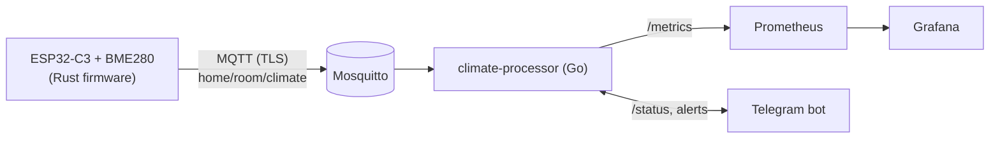

# climate-processor
[](https://github.com/Nurs717/climate-processor/actions/workflows/ci.yml)

A small Go service that turns room climate readings from an ESP32 + BME280 sensor into Prometheus metrics and answers questions about them in a Telegram bot.



The sensor publishes `{"temperature": 21.5, "humidity": 45.2, "pressure": 101325}` (°C, %, Pa) every few seconds. The service validates each message, updates the metrics and keeps the latest reading for the bot.

## Features

- **Reliable MQTT client**: subscribes on every (re)connect, retries until the broker is reachable, optional TLS with a private CA and username/password.
- **Input validation**: missing fields and values outside the BME280 range are rejected and counted in `climate_messages_rejected_total{reason}`.
- **Stale-data detection**: if no reading arrives for `STALE_AFTER`, `/status` says so and the bot sends one "sensor is silent" alert, and one more when data resumes.
- **Telegram bot** with admin-approved access. A new person sends `/start`, the admin gets a message with **Allow / Deny** buttons. Admins also have `/users` (list, remove) and `/remove <chat id>`. Approved users are stored in a file and survive restarts. `/status` shows the temperature, humidity, pressure in mmHg and the time in the configured timezone.
- **Prometheus metrics** and a `/healthz` endpoint on one HTTP port.
- **Graceful shutdown** on SIGINT/SIGTERM, HTTP server timeouts, small Alpine-based Docker image that runs as a non-root user and has a healthcheck.

## Project layout

```
cmd/app/            entry point: wiring, HTTP server, graceful shutdown
internal/config/    environment-based configuration
internal/domain/    payload and reading types
internal/handler/   MQTT subscriber and Telegram bot
internal/metrics/   Prometheus metrics
internal/service/   validation, state, staleness watcher
deploy/local/       one-command local stack: broker, service, Prometheus, Grafana
deploy/gcp/         cloud deployment: Mosquitto (TLS, ACL) + service on a small VM, CI/CD setup
Makefile            everyday commands (run `make` to list them)
```

## Quick start (local, one command)

Requires Docker and `make`.

```bash
make up        # broker + service + Prometheus + Grafana
make send      # publish a test reading (make send T=25 H=60)
make metrics   # see the room_* metrics
make down
```

Prometheus: http://localhost:9090, Grafana: http://localhost:3000 (admin/admin, Prometheus is preconfigured).
To try the Telegram bot, copy `deploy/local/.env.example` to `deploy/local/.env`, fill it in and run `make up` again.
Message the bot `/start`: while no admin is configured it shows your chat ID. Put it into `TELEGRAM_ADMIN_CHAT_IDS` and restart; from then on you are the admin and everybody else asks for access with `/start`.

Without Docker you need an MQTT broker on `127.0.0.1:1883`; then `make run` starts the service and `make test` runs the tests. Run `make` to list all commands.

This is the local setup. Running it in the cloud with automatic deployment from GitHub Actions is described in [`deploy/gcp/README.md`](deploy/gcp/README.md).

## Configuration

| Variable | Default | Description |
|---|---|---|
| `MQTT_BROKER_URL` | `tcp://127.0.0.1:1883` | Broker URL (`tcp://`, `ssl://`) |
| `MQTT_CLIENT_ID` | `go_climate_worker` | MQTT client ID |
| `MQTT_TOPIC` | `home/room/climate` | Topic with sensor readings |
| `MQTT_USERNAME`, `MQTT_PASSWORD` | empty | Broker credentials |
| `MQTT_CA_FILE` | empty | PEM file of the CA that signed the broker certificate |
| `MQTT_TLS_SERVER_NAME` | empty | Name expected in the broker certificate |
| `METRICS_PORT` | `:2112` | Listen address for `/metrics` and `/healthz` |
| `TELEGRAM_BOT_TOKEN` | empty | Bot token from @BotFather (bot disabled if empty) |
| `TELEGRAM_ADMIN_CHAT_IDS` | empty | Comma-separated chat IDs of the administrators (always have access, approve and remove users) |
| `ACCESS_FILE` | empty | JSON file with the users approved in the bot (empty = kept in memory only). The Docker setups use `/data/access.json` on a volume |
| `TIMEZONE` | `Asia/Almaty` | IANA timezone for displayed time |
| `STALE_AFTER` | `5m` | Silence duration after which data is considered stale |

## Metrics

| Metric | Meaning |
|---|---|
| `room_temperature_celsius` | Temperature |
| `room_humidity_percent` | Relative humidity |
| `room_pressure_pascal` | Pressure |
| `room_last_update_timestamp_seconds` | Unix time of the last accepted reading |
| `climate_messages_rejected_total{reason}` | Rejected messages: `parse`, `missing_field`, `out_of_range` |

Example alert expression: `time() - room_last_update_timestamp_seconds > 300`.

## Docker

```bash
docker build -t climate-processor .
```

Deploying to the cloud (a small Google Cloud VM with Mosquitto over TLS, password file and per-user ACLs, plus this service, updated automatically by GitHub Actions) is described in [`deploy/gcp/README.md`](deploy/gcp/README.md). This README covers local development.

## Security notes

- The broker is meant to be exposed only over TLS (port 8883) with per-device credentials; the ACL lets the sensor publish and the service only subscribe.
- Secrets (`.env`, private keys, the password file) are git-ignored; never commit them. A bot token that was ever exposed should be revoked in @BotFather.
