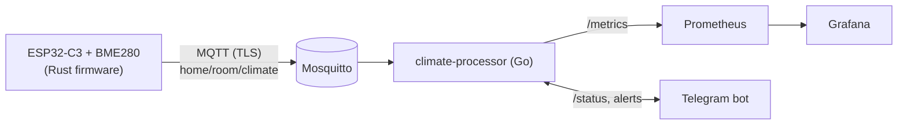

# climate-processor

A small Go service that turns room climate readings from an ESP32 + BME280 sensor into Prometheus metrics and answers questions about them in a Telegram bot.



The sensor publishes `{"temperature": 21.5, "humidity": 45.2, "pressure": 101325}` (°C, %, Pa) every few seconds. The service validates each message, updates the metrics and keeps the latest reading for the bot.

## Features

- **Reliable MQTT client**: subscribes on every (re)connect, retries until the broker is reachable, optional TLS with a private CA and username/password.
- **Input validation**: missing fields and values outside the BME280 range are rejected and counted in `climate_messages_rejected_total{reason}`.
- **Stale-data detection**: if no reading arrives for `STALE_AFTER`, `/status` says so and the bot sends one "sensor is silent" alert, and one more when data resumes.
- **Telegram bot** with a chat-ID allowlist. Commands: `/start` (shows your chat ID), `/status` (current temperature, humidity, pressure in mmHg, time in the configured timezone).
- **Prometheus metrics** and a `/healthz` endpoint on one HTTP port.
- **Graceful shutdown** on SIGINT/SIGTERM, HTTP server timeouts, small Alpine-based Docker image that runs as a non-root user and has a healthcheck.

## Project layout

```
cmd/app/            entry point: wiring, HTTP server, graceful shutdown
internal/config/    environment-based configuration
internal/domain/    payload and reading types
internal/handler/   MQTT subscriber and Telegram bot
internal/metrics/   Prometheus metrics
internal/service/   validation, state, staleness watcher
deploy/gcp/         Mosquitto (TLS, ACL) + service for a small cloud VM
```

## Run locally

Requires Go (see `go.mod`) and an MQTT broker reachable at `tcp://127.0.0.1:1883` (or set `MQTT_BROKER_URL`).

```bash
go test ./...
TELEGRAM_BOT_TOKEN=<token> TELEGRAM_ALLOWED_CHAT_IDS=<your chat id> go run ./cmd/app
```

Send a test reading:

```bash
mosquitto_pub -h 127.0.0.1 -t home/room/climate -m '{"temperature":21.5,"humidity":45,"pressure":101325}'
curl -s localhost:2112/metrics | grep room_
```

Message the bot `/start` to see your chat ID, add it to `TELEGRAM_ALLOWED_CHAT_IDS`, restart, then use `/status`.

`docker-compose.yml` in the repository root starts Prometheus and Grafana for local development (adjust the scrape target in `prometheus.yml` to where the service runs).

## Configuration

| Variable | Default | Description |
|---|---|---|
| `MQTT_BROKER_URL` | `tcp://127.0.0.1:1883` | Broker URL (`tcp://`, `ssl://`) |
| `MQTT_CLIENT_ID` | `go_climate_worker` | MQTT client ID |
| `MQTT_TOPIC` | `home/room/climate` | Topic with sensor readings |
| `MQTT_USERNAME`, `MQTT_PASSWORD` | empty | Broker credentials |
| `MQTT_CA_FILE` | empty | PEM file of the CA that signed the broker certificate |
| `MQTT_TLS_SERVER_NAME` | empty | Name expected in the broker certificate |
| `METRICS_PORT` | `:2112` | Listen address for `/metrics` and `/healthz` |
| `TELEGRAM_BOT_TOKEN` | empty | Bot token from @BotFather (bot disabled if empty) |
| `TELEGRAM_ALLOWED_CHAT_IDS` | empty | Comma-separated chat IDs allowed to read data |
| `TIMEZONE` | `Asia/Almaty` | IANA timezone for displayed time |
| `STALE_AFTER` | `5m` | Silence duration after which data is considered stale |

## Metrics

| Metric | Meaning |
|---|---|
| `room_temperature_celsius` | Temperature |
| `room_humidity_percent` | Relative humidity |
| `room_pressure_pascal` | Pressure |
| `room_last_update_timestamp_seconds` | Unix time of the last accepted reading |
| `climate_messages_rejected_total{reason}` | Rejected messages: `parse`, `missing_field`, `out_of_range` |

Example alert expression: `time() - room_last_update_timestamp_seconds > 300`.

## Docker

```bash
docker build -t climate-processor .
```

A ready-made stack for a small cloud VM (Mosquitto with TLS, password file and per-user ACLs, plus this service) is in [`deploy/gcp`](deploy/gcp/README.md).

## Security notes

- The broker is meant to be exposed only over TLS (port 8883) with per-device credentials; the ACL lets the sensor publish and the service only subscribe.
- Secrets (`.env`, private keys, the password file) are git-ignored; never commit them. A bot token that was ever exposed should be revoked in @BotFather.
